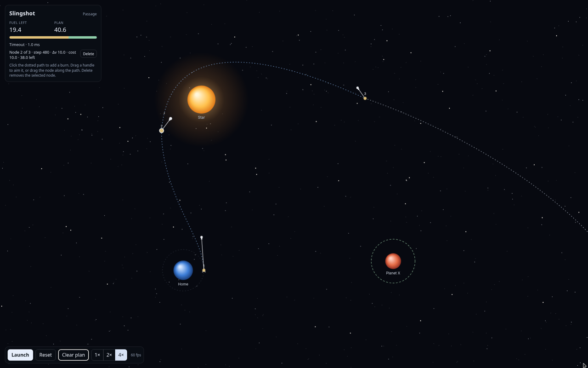
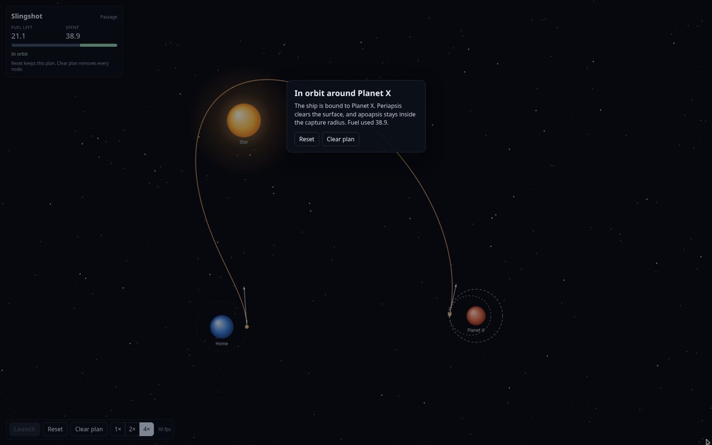

# Slingshot

A ship in orbit around Home has a fixed fuel budget and a plan made of burn nodes. Each node is a sim step on the predicted path and an impulsive delta-v applied there. The launch burn can sit at step 0. A later node at Planet X's sphere is what captures the ship: specific orbital energy below zero, periapsis above the surface, and apoapsis inside the capture radius. The star in between makes that much cheaper than a route that stays clear of it.

Prediction and flight use the same fixed-step integrator. Editing a node recomputes from that node forward, and the path before it stays put. Passage can be planned before launch. Relay cannot: the predicted line has a horizon, only two burns can be queued, and the capture burn is added on a pause mid-flight. Winning is still a stable orbit around Planet X.

## Planning

- [Roadmap](docs/ROADMAP.md) — work packages and their status.
- [Design](docs/DESIGN.md) — vision, physics rules, and architecture.

## Run

```bash
npm install
npm run dev
```

Then open the URL Vite prints (http://localhost:5173).

```bash
npm test
npm run build
```

`npm test` runs Vitest. `npm run build` typechecks and bundles.

## How to play

- The dotted line is the coast the ship will fly. Click it to add a burn node at that sim step. Step 0, on the ship, is the launch node.
- Drag a node's handle to set direction and strength. Drag the node marker to slide it along the path. Delete (button or the Delete key) removes the selected node. Clear plan removes every node.
- The readout shows the plan total, the selected node's burn and fuel cost, and the fuel left. A node that costs more than the fuel remaining when the ship reaches it is marked in red. That plan cannot launch.
- The path after each node is the trajectory that burn produces. Where the clock runs normally the line stays cool. Where time slows it glows orange. The ring at the end of the line, and the closed ellipse, still show the outcome: green for an orbit around Planet X, blue for a flyby, red for a crash.
- Launch flies the plan. Burns fire at their steps. 1× / 2× / 4× run more fixed steps per frame. Slow runs one fixed step every other frame. The time step never changes, so the path does not change.
- Pause freezes the ship so you can add or edit burns that have not fired yet, then resume. Passage can pause without limit. A level may instead allow a fixed number of pauses, or charge a score each time. The step does not advance while paused, so the trajectory stays the same.
- A captured orbit is bound to Planet X, clears the surface, and stays inside the dashed ring. Missing that and leaving the ring is lost in space. Hitting a body is a crash. Leaving the chart or running out of time is also lost in space.
- Drag empty space to pan. Scroll to zoom. The level menu switches systems and returns to planning.
- Reset returns to planning and keeps the nodes. Space launches, and pauses or resumes in flight. P does the same. S toggles slow motion. R resets. 1, 2, and 4 set the speed.

### Relay

Choose Relay in the level menu. Planet X circles a fixed point, and a moon circles Planet X. Both move on rails keyed by sim time, so the prediction and the flight see the same places.

The readout shows the horizon in seconds. That is how far the dotted line reaches. It gets shorter where gravity is strong. Only two burns can be queued at once. Relay also gives you three pauses.

Leave Home with a departure burn aimed toward Planet X's path, and put a small correction on the visible line. Those two burns are the whole plan you can commit before launch, and they do not capture: the ship meets Planet X and hits it. The capture burn sits past the opening horizon, and there is no free slot for it until the correction has fired.

Launch, then pause once Planet X is inside the horizon (the capture step in the reference solution is 2605, and step 2300 can already see it). Click the line to add the third burn, drag it until the path closes into a green orbit, and resume. Slow motion makes that approach easier to time. The fuel budget is **50**. The reference departure, correction, and capture together cost **48.87**.

### Rescue

Choose Rescue in the level menu. A black hole, drawn as a dark disc with a bright ring, sits between Home and Planet X. Its surface is the horizon. The speed of light on this level is a lowered constant, `c = 42`.

Ship time and outside time are different clocks. Outside time is the coordinate time Home and Planet X share. Ship time is the crew's proper time:

```
Φ_depth = Σ GM / r
dτ/dt = sqrt(1 - 2 Φ_depth / c² - v² / c²)
```

With the default physics knobs the value under the square root is clamped at 0, so the rate is 0 on a horizon or at `v ≥ c` and never becomes imaginary. Each fixed step adds `dt` to outside time and `(dτ/dt) * dt` to ship time, using the rate at the start of the step. Prediction and flight both do this inside `step`. A level can override the knobs; omitted knobs keep this formula and the inverse-square force.

The clock panel shows both clocks, the rate as `1 ship s = N outside s`, the gap (outside minus ship), and a deadline bar in outside time. The bar turns red in the last fifth of the window and when the window is already gone. While you are still planning, the panel shows the predicted arrival. In flight the clocks tick with the ship. The predicted line is tinted by the same rate. Aberration and colour shift appear only while flying; planning and pause stay on the clean chart.

Arrival is still a stable orbit around Planet X. Missing the outside-time deadline is a hard fail even if that orbit is captured: no points and no stars. Under the deadline, ship time saved against the crew budget is a bonus and leftover fuel adds points. The three stars are deadline, crew time, and fuel. Passage weights crew time (a generation ship) and can pause for free. Rescue weights the deadline and charges 8 score points per pause. That pause cost, the WP4 score rule, is subtracted from the mission points.

Safe arc and Deep dive load the two reference plans.

- Safe arc stays wide of the hole. It arrives inside the 26.4 s deadline, spends more fuel, and ages the crew more. One star: the deadline. Crew and fuel stars are missed.
- Deep dive swings inside two horizon radii. Proper time stalls (the rate hits 0), so the crew ages less and the burn is cheaper, but outside time runs past 26.4 s. The orbit is real and the mission is a hard fail.

The fuel budget is **50**. Pausing spends the score budget and comes off the points if you do make the deadline.

## Level files and physics knobs

Passage, Relay, and Rescue are JSON files in `src/levels/`. `src/level/schema.ts` is the typed schema. `loadLevelJson` / `loadLevelData` reject malformed JSON and unknown or out-of-range fields with a path on each error (`level.physics.p must be greater than 1`). The reference burns stay in `src/level/solutions.ts`.

An optional `physics` object overrides the integrator. Every field has a default that is today's behaviour, so the shipped files omit the block and play the same flights as before.

| Knob | Default | What it does |
| --- | --- | --- |
| `c` | the level's `c` | Speed of light. Lower `c` slows ship time. It does not move the ship. |
| `gravityScale` | `1` | Multiplies `g`. `2` bends a path more than `1`. |
| `eps` | `0` | Softening length. `0` is a point mass. |
| `p` | `2` | Falloff exponent. Force magnitude is `G M / (r² + ε²)^(p/2)`. |
| `dilationStrength` | `1` | Scales both `2Φ/c²` and `v²/c²`. |
| `dilationCap` | none | Max slowdown. `10` means `dτ/dt` stays above `0.1`, approaching that floor smoothly instead of jumping to 0. |
| `tidalStrength`, `dragStrength` | `0` | Stored only. The sim does not read them yet. |

The potential is the integral of that force, so the clock rate and the gravity map use the same field as the acceleration. Prediction and flight share `SimConfig`, so a knob cannot change one and not the other.

```json
"physics": {
  "c": 80,
  "gravityScale": 1.5,
  "eps": 12,
  "p": 2.2,
  "dilationStrength": 1,
  "dilationCap": 10
}
```

The clock panel rounds the rate, the time gap, and the deadline margin to three significant figures (and no finer than a centisecond). Each of those three has an arrow: rising, falling, or steady. The arrow holds until the value reverses by more than a small deadband, so it does not flicker.

The fuel budget on Passage is **60**. A slingshot launch plus its capture node costs **38.91** (22.00 + 16.91). The direct route costs **95.18** (76.00 + 19.18), which is over budget, so it cannot launch. A modest burn along the ship's orbital motion is the one that fits.





## Layout

- `src/sim/physics.ts` — gravity, fixed-step velocity Verlet, burn nodes, analytic orbits, the planning horizon, the two clocks, the physics knobs, and the cached prediction. No DOM. Prediction and flight both call `advancePlan`. The horizon stops the predicted line only. `c` and the dilation knobs do not change the motion. `gravityScale`, `eps`, and `p` do.
- `src/sim/score.ts` — arrival, the outside-time deadline, crew and fuel stars, and the WP4 pause charge. No DOM.
- `src/levels/*.json` — Passage, Relay, and Rescue. Passage queues up to eight burns and pauses for free. `c` is high, so the clocks stay close, and crew time is weighted above fuel. Relay puts Planet X and its moon on rails, with a short horizon, two queued burns, and three pauses. Rescue has a black hole, a 26.4 s outside-time deadline, and score-priced pauses.
- `src/level/schema.ts` — the level type and the validating loader.
- `src/level/catalog.ts` — loads the three files and builds `SimConfig`.
- `src/level/solutions.ts` — reference burns for Passage, Relay, and Rescue.
- `src/hud/readout.ts` — rounded clock text and the trend arrows. No DOM.
- `src/render/` — orthographic Three.js view (WebGL). The HUD and result cards are HTML over the canvas. A parked perspective camera sits on the same world group for a later tilted view.

## Swapping a visual

v1 is flat and calm on purpose. A later pass can replace one element with something realistic (a textured planet, a bloom star, a glTF ship) without touching the sim or the other elements.

Colors, sizes, and asset paths live in `src/render/theme.ts`. Each element is built by one factory in `src/render/visuals/index.ts`. A factory returns a `Visual` (`src/render/visual.ts`): an object, a space (`background`, `world`, or `screen`), and `update` / `dispose`. The view only walks that list.

| Element | Factory to replace | Theme keys | What a realistic version would load |
| --- | --- | --- | --- |
| Starfield | `createStarfield` | `assets.starfield`, `starfield` | A real catalog or cubemap. Stay screen-fixed unless you also add parallax. |
| Star | `createStar` | `assets.star`, `star` | A textured star. Bloom belongs here, not on the whole scene. |
| Planets | `createPlanets` | `assets.planetStart`, `assets.planetX`, `planet` | Lit textured meshes. The star's position is already the light direction. |
| Ship | `createShip` | `assets.ship`, `assets.shipThrust`, `ship`, `thrust` | A glTF on the same group. Keep the heading lerp and the screen-pixel size rule, or drop the size rule if the model should scale with the world. |
| Trail | `createTrail` | `assets.trail`, `trail` | Another ribbon. Read `game.trail`; do not trim it in the sim. |
| Path | `createPath` | `assets.predictedPath`, `path` | Another dotted or meshed look-ahead. Read `game.prediction` only. |
| Nodes | `createNodes` | `assets.dragArrow`, `nodes` | Another handle. The tip must stay on `burnHandleOffset`, which is what clicking and dragging hit-test. |
| Relativity | `createRelativity` | flight ship pose and `level.c` | Aberration and colour shift. It hides itself unless the mode is flying. |

Replace the factory in `visualFactories` and, if the new file path differs, the matching `theme.assets` entry. Leave `src/sim`, `src/game`, and the other factories alone.
- `src/game/` — the plan, flight, and pointer input.
- `tests/` — prediction matches flight at 1×, 2×, and 4× with three nodes; the same match with orbiting bodies; editing a later node leaves the earlier path unchanged; the slingshot captures inside the budget and the direct plan is over it; an over-budget plan cannot launch; pausing and slow motion do not change a trajectory; pause rules are enforced; Relay's opening plan does not win and the mid-flight capture does; clock rates match the dilation formula; prediction and flight share proper time; the deadline is a hard fail; Rescue's deep route saves fuel and crew time and spends outside time.

## Continuous integration

`.github/workflows/ci.yml` runs `npm test` and `npm run build` on Ubuntu with Node 22.
